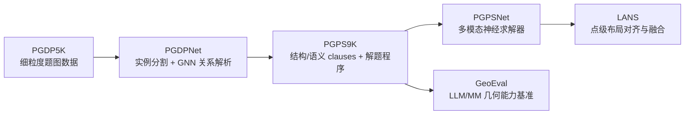

# 几何题图解析与求解论文阅读笔记

日期：2026-09-30
范围：用户提供的 7 篇论文
说明：几何方向的 6 篇论文根据正式论文页和公开 PDF 阅读；长尾识别论文的出版社全文在当前环境不可直接取得，以下内容依据 ScienceDirect 的正式摘要、章节摘录和作者/DBLP 元数据整理，涉及具体数值时只采用公开摘要中可核对的信息。

## 先看结论

这组论文形成了一条比较完整的技术路线：

最值得迁移到 Geosym-World 的不是某个模型结构，而是三层契约：

1. **观测层**：题图被拆成带位置的 primitive、文本、符号及其关系。
2. **语义层**：primitive 关系被转成结构 clauses、语义 clauses 或更严格的几何形式语言。
3. **求解层**：解题过程被表达为可执行、可验证的 theorem/operator program，而不是只输出最终答案。

这些论文也暴露了一个共同问题：论文中的主实验经常使用真实标注的图解析结果，因而会把“解析错误”和“推理错误”分开；实际系统若直接接收预测解析结果，性能会显著下降。GeoEval 则从另一侧说明，最终答案准确率很容易受到训练数据泄漏、题目重写和答案抽取方式影响，不能单独作为几何理解的充分证据。

## 论文总览

| 论文 | 年份/来源 | 类型 | 核心对象 | 主要贡献 | Insight | Completeness | 数值证据 | 综合 |
|---|---:|---|---|---|---:|---:|---:|---|
| [PGDP5K: A Diagram Parsing Dataset for Plane Geometry Problems](https://ieeexplore.ieee.org/abstract/document/9956397/) | ICPR 2022 | pure benchmark | 题图解析数据集 | 5,000 张图、primitive 级位置/类别/关系标注 | 5 | 4 | N/A benchmark | A |
| [Plane Geometry Diagram Parsing](https://www.ijcai.org/proceedings/2022/228) | IJCAI 2022 | method + benchmark | PGDPNet | 几何实例分割、关系 GNN、几何形式语言生成 | 5 | 4 | 5 | A |
| [Learning to Understand Plane Geometry Diagram](https://mathai2022.github.io/papers/6.pdf) | MATH-AI Workshop 2022 | method + benchmark | PGDPNet | IJCAI 工作的早期/短版呈现 | 4 | 3 | 4 | B |
| [A Multi-Modal Neural Geometric Solver with Textual Clauses Parsed from Diagram](https://www.ijcai.org/proceedings/2023/376) | IJCAI 2023 | method + benchmark | PGPSNet、PGPS9K | clauses + 预训练 + 解题程序 | 5 | 5 | 5 | A |
| [LANS: A Layout-Aware Neural Solver for Plane Geometry Problem](https://aclanthology.org/2024.findings-acl.153/) | Findings ACL 2024 | pure method | 布局感知神经求解器 | MLA-PLM、SSP/PMP、LA-FA | 5 | 4 | 5 | A |
| [GeoEval: Benchmark for Evaluating LLMs and Multi-Modal Models on Geometry Problem-Solving](https://aclanthology.org/2024.findings-acl.73/) | Findings ACL 2024 | pure benchmark | LLM/MM 评测 | 四个子集、难度和反向推理测试 | 4 | 4 | N/A benchmark | A |
| [Towards prior gap and representation gap for long-tailed recognition](https://doi.org/10.1016/j.patcog.2022.109012) | Pattern Recognition 2023 | pure method / theory | 长尾视觉识别 | prior gap + representation gap 统一分析 | 4 | 4 | 4 | B |

分数只表示这份阅读笔记中的证据强度和工作完整度，不表示录用概率或方法优劣的绝对排名。

## 逐篇阅读

### 1. PGDP5K：先把“题图解析”变成可研究的任务

**问题。** 既有几何题数据集通常只有粗粒度题图信息，不能监督模型识别细线段、圆弧、角度标记、文本类别及 primitive 间关系。PGDP5K 将题图解析单独提出为基础任务。

**数据和标注。** 数据集包含 5,000 张图：1,813 张来自去重后的 Geometry3K，3,187 张来自 6–12 年级教材。覆盖 16 类形状、5 类位置关系、22 类符号和 6 类文本类型，按 7:1:2 划分训练/验证/测试。标注包括：

- 几何 primitive：点、线、圆/弧及其像素位置；
- 非几何 primitive：符号和文本的框、类别、OCR 内容；
- primitive 关系：geo2geo、text2geo、sym2geo、sym2text；
- 由关系和几何先验自动生成唯一的几何描述语言（GDL）。

这套标注把“看到了什么”和“这些元素如何组成几何命题”放在同一个数据契约中。数据明显长尾，三角形和圆占比较高，少数复杂形状与符号更难。

**基准结果。** 论文用 Freeman、GEOS、InterGPS 等方法测试。PGDP5K 上，InterGPS 的全部关系 GDL F1 只有 66.07%；这说明数据集有足够难度，也说明粗粒度图检测不是几何推理的可靠替代。论文还显示，把 Geometry3K 按细粒度规则重新标注为 IMP-Geometry3K 后，解析结果明显改善，表明标注协议本身会影响下游求解上限。

**局限和启示。** PGDP5K 主要是题图级数据，解题文本和完整解题轨迹不是核心标注；关系模板依赖人工设计的几何先验。它非常适合作为 parser 的观测层基准，但不能单独评估 theorem selection、数值求解或证明完整性。

### 2. Plane Geometry Diagram Parsing：PGDPNet 把解析做成端到端图推理

**核心想法。** PGDPNet 将题图解析拆成三个子任务并联合训练：primitive 检测/识别、primitive 关系构图、几何形式语言生成。模型包含：

- FPN backbone 和带尺度适配的非几何 primitive 检测模块；
- 几何分割模块（GSM）：语义分割 + embedding 聚类，在像素级区分细长且重叠的线/弧；
- 视觉-位置 embedding；
- GNN 关系模块：把 primitive 视为节点、关系视为边，融合视觉、空间和类别语义。

与普通 scene graph generation 的关键区别是：几何 primitive 很容易在 bounding box 中重叠，必须使用 mask；很多关系可以由 primitive 类型和几何先验推出，不需要独立预测一个自然语言 predicate。

**结果。** 在 PGDP5K 上，PGDPNet 的点、线、圆检测 F1 分别为 99.68、99.40、99.90（位置评估口径）。在 IMP-Geometry3K 上，将 PGDPNet 生成的图命题接入 InterGPS 后，问题求解准确率达到 74.1%，而使用 InterGPS 图解析器为 57.5%；使用 GNN 比不使用 GNN 进一步提高约 4.8 个百分点。论文还报告，PGDP5K 的 GDL 全关系结果远低于 IMP-Geometry3K，说明真实教材图的布局与关系更复杂。

**失败模式。** 切线点、细小符号、文本类别仍会导致错误；GDL 的任何前置解析错误都会传递到求解器。这个结论对当前仓库很重要：parser 输出应保持 hypothesis 和 provenance，不能因为局部检测分数高就直接物化为可信事实。

### 3. Learning to Understand Plane Geometry Diagram：同一方向的早期短版

这篇 MATH-AI Workshop 论文与 IJCAI-22 论文的技术主线基本相同：PGDPNet、GSM、视觉-位置 embedding、GNN 关系推理，以及 PGDP5K/IMP-Geometry3K 评测。它的价值主要在于清楚地给出任务定义和模型总览，适合快速理解该研究方向的起点。

相对 IJCAI 正式论文，短版对实验细节、失败案例和几何形式语言评价展开较少。因此阅读时应把它看作方法的早期公开版本，而不是第二个独立方法。其中心判断是：**几何图解析不是 OCR 加几条规则，而是实例级分割、空间关系建模和几何先验联合推理。**

### 4. PGPSNet：从“解析图”走向“可执行解题程序”

**数据集 PGPS9K。** PGPS9K 包含 9,022 道题，配套 4,000 张去重题图；其中 2,891 道题和 1,738 张图来自 Geometry3K，其余来自五套教材。数据覆盖 30 类平面几何问题，平均每题约 2.43 个 operator、7.45 个 program token，超过 90% 的题目依赖图中没有在文字里完整给出的条件。

每题同时有：

- **结构 clauses**：如若干点按顺序共线、点在圆上；
- **语义 clauses**：长度、角度、垂直、平行等条件；
- **文本题干**；
- **可执行 solution program**：34 个 theorem/operator、55 类 operand，并允许 process variable 在步骤间传递。

**PGPSNet 结构。** 图像由 CNN 编码，clauses 和题干输入结构/语义预训练语言模型，再通过双向 GRU 融合，最后由 self-limited GRU 解码器生成程序。self-limited decoder 将变量和操作候选限制在题目实际出现的词汇中，降低搜索空间；程序执行器用符号代数计算最终答案。

**五种增强。** token replacement、connection rotation、representation transposition、clauses shuffle、diagram flip，分别覆盖点名替换、连接顺序等价、几何表达等价、条件顺序变化和图像变换。

**结果。** 在 Geometry3K 上，PGPSNet 的数值答案 Completion/Choice/Top-3 为 65.0/77.9/80.7%；在 PGPS9K 上为 62.7/70.4/79.5%。语言模型预训练的消融增益最大：Geometry3K Completion 从 38.4 提升到 65.0；self-limited decoder、数据增强和结构 clauses 也都有贡献。

**局限。** 论文明确承认与人类专家仍有较大差距，复杂题中常见“第一步正确、第二步 theorem 选择错误”。实验还大量使用由真值图标注生成的 clauses；因此真实 parser 误差下的端到端效果不能直接由表中数字推出。

### 5. LANS：补上 clauses 丢失的布局信息

**动机。** PGPSNet 的 clauses 能表达连接和语义关系，但文本化会丢掉点的相对位置。例如两个图可以产生相同的 clauses，却对应锐角/钝角不同、解法不同的题。LANS 将布局坐标重新引入多模态融合。

**两个新模块。**

- **MLA-PLM**：在原结构-语义预训练（SSP）上加入 point-match pre-training（PMP），用对比学习对齐图像 patch 中的视觉点和 clauses 中的文本点；
- **LA-FA**：在跨模态 attention 中使用由点位置引导的 attention mask，使相关图像区域与对应文本 token 更容易交互。

输入仍是图像、结构 clauses、语义 clauses 和题干，输出可执行 solution program。

**结果。** LANS 在 Geometry3K 上的 Completion/Choice/Top-3 为 71.3/82.3/82.0%，在 PGPS9K 上为 66.1/73.8/81.7%；相较 PGPSNet，Geometry3K Completion 提升 6.3 个百分点。消融显示：无预训练 38.2%，仅 SSP 55.4%，仅 PMP 66.9%，SSP+PMP 71.3%；布局感知 mask 比普通 attention 再提升到 71.3%。论文还报告 LANS 约 26M 参数，明显小于通用多模态大模型。

**边界。** 布局对齐目前主要围绕点 primitive；高层几何实体、复杂文本和冗余解码仍未完全解决。论文的 case study 显示，LANS 能处理边对应关系、polygon 边数和角度朝向，但一个复杂切线布局案例中所有 solver 都失败。

### 6. GeoEval：把评测对象从专用 solver 扩展到 LLM/MM

**数据设计。** GeoEval 从 24,912 道公开几何题中整理出四个子集：

- **GeoEval-2000**：2,000 道主集，来自 7 个公开数据源，统一格式；
- **GeoEval-backward**：750 道，把正向题答案的一部分遮住，测试反向和多步推理；
- **GeoEval-aug**：2,000 道，由 GPT-3.5 为主集改写，测试词面变化和潜在数据泄漏；
- **GeoEval-hard**：300 道，重点加入立体几何和解析几何，并经过变量、条件和答案重构及多轮人工审查。

主集覆盖平面、立体、解析几何，既有文本题也有图文题，并附带复杂度等级。答案评测使用 GPT-4 抽取模型输出，再用规则/正则补齐；作者在 200 个样本上人工检查，抽取准确率超过 97%。

**主要数字。** 十个 LLM/MM 做 zero-shot 评测：

- WizardMath-70B 在 GeoEval-2000 达到 55.67%，WizardMath-7B-V1.1 为 54.78%；
- GeoEval-hard 上两个 WizardMath 都只有 6.00%，说明数学语料预训练并不等于新题泛化；
- mPLUG-Owl2 是主集多模态模型最高者（37.76%），在 backward 和 hard 分别为 35.33% 和 22.66%；
- 给题目补充几何图描述后，GPT-4V 提升 5.33 个百分点，WizardMath-7B 提升 18.73 个百分点；
- GPT 系列在改写题上的成绩提升，提示 self-rephrasing 可能是推理前处理，但论文也承认这一结论不一定能推广到所有题型和模型。

**评测风险。** InstructBLIP 在主集和 hard 集出现异常高分（hard 70.30%），回答常直接给选项字母而缺少推理，作者因此将其从后续讨论中排除。GeoEval 的明确局限包括：主要看最终答案，忽略解释质量；hard 集仍可能受题型和常数知识影响；改写收益与模型/数据源存在交互。对 Geosym-World 来说，GeoEval 更适合作为外部能力压力测试，不能替代逐步的 parse graph、solver trace 和 verifier 指标。

### 7. Prior gap / representation gap：与几何主线平行的长尾识别分支

这篇 Pattern Recognition 论文研究的是一般图像长尾识别，不是几何题图解析。它从 Bayesian classifier 和模型优化两个角度，把不平衡学习的问题拆为：

- **prior gap**：类别先验偏移导致决策边界偏斜；
- **representation gap**：尾部类别特征空间表征不足。

作者认为传统重采样/重加权主要缓解 prior gap，却可能放大 representation gap；因此提出同时处理两者的方案：prior calibration，以及代表性特征提取、优化策略调整、有效样本建模三类策略。公开摘要称方法在 CIFAR10-IMB、CIFAR100-IMB、ImageNet-LT、iNaturalist2018 和 Places-LT 五个基准上优于对比方法。

**对本项目的有限启示。** PGDP5K、PGPS9K 的 primitive、符号和关系分布本身是长尾的。可以借用这篇论文的诊断视角分别报告“类别先验不均衡”和“尾部 primitive 表征不足”，但不能把长尾识别结论直接当成几何解析结论。需要在几何数据上做独立的 head/mid/tail 切片和关系级误差分析。

## 横向比较：每篇论文解决了哪一层

| 层次 | 代表论文 | 输入 | 输出 | 主要评价 | 仍缺什么 |
|---|---|---|---|---|---|
| 观测/解析 | PGDP5K、PGDPNet | 图像 | primitive、位置、关系、GDL | 检测 P/R/F1、关系 F1、GDL 等价性 | 预测不确定性、跨图风格、真实 OCR/解析误差 |
| 语义表示 | PGPS9K、PGPSNet | 图像 + clauses + 题干 | theorem/operator program | 答案与程序 Completion/Choice/Top-3 | parser hypothesis 进入 solver 后的误差传播 |
| 布局融合 | LANS | 图像 patch + clauses + 题干 | solution program | Geometry3K、PGPS9K | 高层实体对齐、复杂布局、可验证中间状态 |
| 通用模型评测 | GeoEval | 文本/图像题 | 最终答案 | 子集准确率、复杂度切片 | 过程正确性、污染控制、答案抽取偏差 |
| 数据不平衡 | prior/representation gap | 长尾图像分类 | 类别预测 | 五个长尾基准 | 几何关系长尾是否同样成立需另证 |

## 对 Geosym-World 的可执行启示

1. **把 PGDP5K 的 primitive-level annotation 转成 ParseGraph 输入适配层。** 每个点、线、圆、文本、符号都应带几何类别、位置、来源和置信度；多元关系可在内部保留 hyper-edge，再按 solver 需要投影成二元边。
2. **把 PGPS9K 的 clauses 和 solution program 分开存储。** clauses 是观测解释，solution program 是推理轨迹；两者都不能直接等同于持久事实。应保留 `hypothesis -> admission -> verified fact` 的状态转换。
3. **优先实现程序执行和 verifier，而不是只追求最终答案。** PGPSNet 的程序表示适合作为 solver trace 的参考；Geosym-World 可以进一步检查每一步 theorem 的前提是否在当前状态中成立、数值是否可复算、目标是否被真正得到。
4. **将 LANS 的布局信息变成显式几何特征。** 点坐标、线段端点、符号与文本的空间关联可以作为 relation scoring 和重绘验证的特征，但不能用图像坐标的“看起来像”替代几何事实。
5. **设计三种评测口径。** 至少同时报告 primitive/关系解析、形式状态或程序正确性、最终数值答案；再增加 head/mid/tail、题型、复杂度和是否依赖图像的切片。
6. **把 GeoEval 的风险纳入 benchmark contract。** 记录数据来源、是否公开、是否可能被训练集污染、改写策略和答案抽取器版本；对外报告时不要把 answer accuracy 写成完整几何理解能力。

## 需要谨慎引用的地方

- PGDPNet 和 PGPSNet 的部分主实验使用真值或高质量人工生成的 clauses；引用结果时必须注明输入条件，不能写成完全端到端真实题图结果。
- GeoEval 的 hard 子集包含由受版权保护的题目集合改写而来的数据；在本仓库中应只借鉴任务设计和统计协议，避免未经授权复制原题内容。
- LANS 论文表格与个别 prose 对消融数字有轻微表述差异，本文采用表格中可直接核对的 71.3% 结果。
- Pattern Recognition 长尾论文在本次环境中未取得出版社全文，因此本文不复述其无法由正式摘要核验的具体表格数字。

## 参考链接

- [PGDP5K — IEEE Xplore](https://ieeexplore.ieee.org/abstract/document/9956397/)
- [Plane Geometry Diagram Parsing — IJCAI-22](https://www.ijcai.org/proceedings/2022/228)
- [Learning to Understand Plane Geometry Diagram — MATH-AI 2022 PDF](https://mathai2022.github.io/papers/6.pdf)
- [A Multi-Modal Neural Geometric Solver with Textual Clauses Parsed from Diagram — IJCAI-23](https://www.ijcai.org/proceedings/2023/376)
- [LANS — ACL Anthology](https://aclanthology.org/2024.findings-acl.153/)
- [GeoEval — ACL Anthology](https://aclanthology.org/2024.findings-acl.73/)
- [Towards prior gap and representation gap for long-tailed recognition — DOI](https://doi.org/10.1016/j.patcog.2022.109012)
