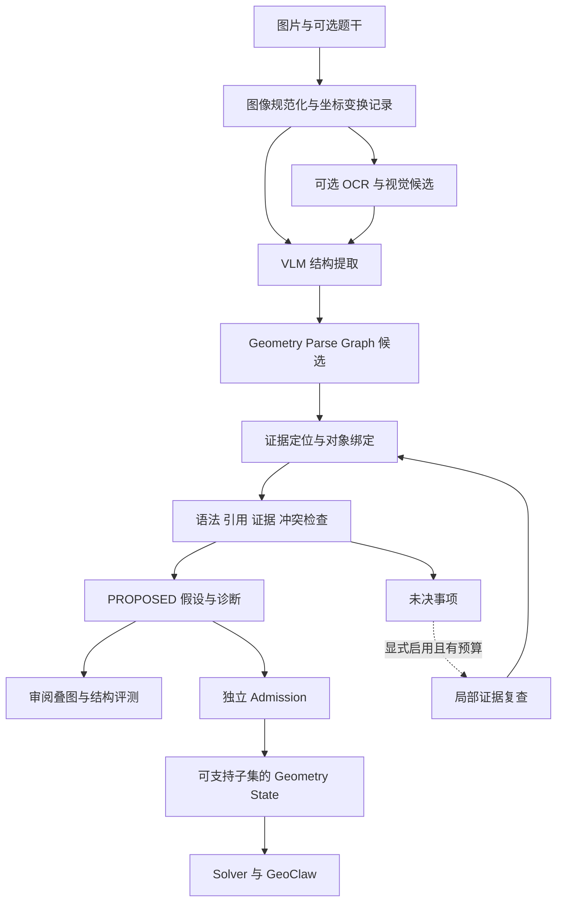

# Parser 设计与后续开发计划

日期：2026-09-09。状态：第一版设计，待审阅；本轮未修改运行时代码、安装依赖、调用模型或开展训练。

后续主计划：见 [可验证几何解析、重建与再合成开发计划](2026-09-09_可验证几何解析重建与再合成开发计划.md)。新版补充参数约束重建、区域集合关系、事实作用域、忠实重绘与再合成，开发范围与阶段验收以新版为准。

扩展调研补充：见 [几何 Parser 概念与路线扩展调研](2026-09-09_几何Parser概念与路线扩展调研.md)。该文细化了本计划的任务边界：`parse_diagram` 负责图面结构和标注语义，`interpret_problem` 负责图文联合条件与目标，state 编译与推导独立；直接 VLM 是 baseline 顺序，不是预定最优方案。原始输出可为紧凑结构，证据定位另设等级，不要求模型一次生成完整 provenance。以下内容据此理解。

## 1. 目标和关键决策

Parser 的目标是把真实几何图片，以及可选的题目文本，转换为可定位、可检查、可供程序使用的几何结构。第一版优先处理规则印刷的 2D 题图，包括点名、线段、圆弧、交点、关系符号、数值表达式、阴影区域及题目目标。

建议采用“模型提取语义结构 + 视觉证据定位 + 确定性检查”的架构。先实现一个短而完整的 VLM baseline，再按误差统计引入专用 OCR、检测和绑定模块。现有 OpenCV Parser 用作诊断对照，现有引擎用作可选执行后端；它们均不限制新版可表达的结构。

核心决策如下：

1. 主要交付物是有证据的几何结构图，不要求每张图都恢复精确数学坐标或解出题目。
2. 图片是视觉证据来源，题干是文本条件来源；推导结果单独保存。三者不能相互冒充。
3. 允许部分解析、未知字段和互斥候选。一个点名模糊，不应导致整张图丢弃，也不应自动补成某个字母。
4. 先比较直接 VLM 与工具辅助 VLM 的真实效果，再决定是否训练专用模型。
5. 合成数据提供可控训练和诊断；少量真实数据从第一轮开发就介入，作为设计是否有效的检验。
6. Geosym-Bench 的发布不依赖 Parser 全部成功。可信合成真值可先形成 solving/debug 轨道，Parser 使用独立 extraction 轨道。

这里修正上一版顺序：不必等 500 条合成验收结束才接触真实图。合成验收和 Parser 小样本开发可以并行推进。

## 2. 本地现状及需要避开的限制

| 已检查的实现 | 可复用能力 | 对新版的限制 |
| --- | --- | --- |
| `Geosym-World/src/geosym_world/parser/contracts.py` | 严格图片/题干输入、PROPOSED 输出契约 | 需要更细的逐对象、逐关系证据和评测契约 |
| `parser/clean_v0.py` | 阶段诊断、基础线圆候选、视觉点 | 默认 OCR 未解析，target 多数只有类型，confidence 是启发式值 |
| `parser/pipeline/hybrid_parse.py:155` | 旧语义提取与可视化流程 | 读取 solution/raw/answer，并向下游传递，不能直接作为公平 baseline |
| `parser/hybrid/semantic_extractor.py:921` | 已有模型调用经验 | 提示词含 known dataset answer；“仅一致性检查”仍属于答案泄漏 |
| `parser/hybrid/formalizer.py` | 关系到结构图的组织经验 | 分类依赖旧 builder 能力，不适合作为新 Parser 的表达边界 |
| `benchmark/parser_v0_evaluator.py` | 诊断报告格式 | 数量相同会得到很高对象分数，关系仅比较类型，不能检验绑定是否正确 |
| `verifier/admission.py:63` | trace 复验、原子状态转换 | 当前接纳要求 executable trace，不能直接接纳任意不完整符号图 |

这些是本次代码阅读得到的判断，不是本轮运行的新实验结论。此前记录的 `251 passed` 是历史验证记录，本轮未重跑测试。

还需审计现有公开 sidecar：字段白名单并不等于彻底无泄漏。生成文件名和样本 ID 可能包含模板、边长或参数；图片输入也不应让模型读取带对象元数据的 SVG 源码。

## 3. 相关方法及对方案的启发

以下为针对设计的定向调研，不声称穷尽领域，也不把论文中的结果当作本项目已验证能力。

| 工作与来源状态 | 已有方法 | 本项目采用的启发与限制 |
| --- | --- | --- |
| [Inter-GPS，ACL 2021](https://aclanthology.org/2021.acl-long.528/)；方法与数据集 | 图文转形式语言，后接符号求解 | Parser 与 solver 分工有先例；题图提取质量需独立评价 |
| [PGDPNet，IJCAI 2022](https://www.ijcai.org/proceedings/2022/228)；方法与数据集 | primitive 分割、图网络关系解析 | 点线圆、符号、符号到对象的关系应分别标注和诊断 |
| [PGDP5K，数据集论文预印本](https://arxiv.org/abs/2205.09947)；数据集 | primitive 位置、类别和关系的细粒度标注 | 可作为真实图的候选监督来源；需要检查与其他数据集的原图重叠 |
| [Geo-TinyLLaVA，ICML 2025 AI4Math Workshop](https://icml.cc/virtual/2025/52421)；方法与训练数据 | 用 Geometry3K 增强数据训练图到形式语言模型 | 直接 VLM 形式化值得作为第一条 baseline；完整点标注前提限制了结论外推 |
| [Geoparsing，Findings of ACL 2026](https://aclanthology.org/2026.findings-acl.1494/)；方法与数据集 | 统一 2D/3D 形式语言；SFT 后结合格式奖励与对照 GT 的按类别 precision 奖励 | 需要比较其公开实现；论文第 5 节的几何奖励依赖 GT，不是无标注图片的自主正确性证明 |
| [PaddleOCR 3.0 技术报告，2025 预印本](https://arxiv.org/abs/2507.05595)；系统工具 | 文本识别与文档解析组件 | 可作为 OCR 候选组件，几何图中的小字母识别和数值绑定需要独立测试 |

补充核验：[PGDP 官方代码](https://github.com/mingliangzhang2018/PGDP)提供 geo2geo、sym2geo、sym2sym 标注格式；[Geo-TinyLLaVA 官方代码](https://github.com/1509cxt/Geo-TinyLLaVA)包含形式化与检测结果合并步骤；[PaddleOCR 公式模块](https://paddlepaddle.github.io/PaddleOCR/main/en/version3.x/module_usage/formula_recognition.html)提供图像到 LaTeX 的独立能力。这些都可借鉴，但需实测依赖、checkpoint、许可证和输入假设后再决定集成。

Geoparsing 的公开项目页和不同版本论文有样本总数口径差异，本计划不以网页总数设定导入数量；正式导入以固定版本文件清单、去重结果和许可证为准。研究选择上的结论是：先做直接形式化 baseline 有公开依据，具体哪个模型最适合当前图片仍需实验决定。

## 4. 两条可比较的路线

| 路线 | 实现方式 | 优点 | 主要风险 |
| --- | --- | --- | --- |
| A：直接 VLM | 原图与题干直接输出紧凑结构和证据引用 | 最快形成端到端结果；可发现脚本漏检对象 | 小字母、密集交点、精确定位和臆测关系 |
| B：工具辅助 VLM | OCR、线圆候选、局部裁剪作为补充输入，VLM 负责语义和绑定 | 便于定位错误，可改善文字和局部结构 | 检测误差传递，输入变长，调用成本上升 |
| C：专用模型训练 | 用真实标注及合成样本训练检测器、关系模型或结构化 VLM | 可降低单位成本、针对固定难点优化 | 标注、训练、部署投入，以及合成到真实迁移风险 |

首轮实现 A，并让 B 的组件可以按实验配置显式开启。A、B 使用同一输出 schema、数据划分和评分程序。C 只有在 A/B 的具体失败类型已确认后启动。

原始 VLM 输出与经过绑定、校验后的输出均保存并分别评分。不能用大量自动补写把框架成功率当成模型解析准确率。

## 5. 总体结构



每个阶段都有输入、输出、版本和错误类型。缺少必需模型或配置时明确失败；`abstained` 是证据不足的正常输出，不是依赖失败时的静默兜底。

### 5.1 输入边界

运行时只允许图片像素、公开题干、版本化解析配置。题干为空时执行 diagram-only 模式；完整图文模式中的 target 来自公开提问内容。

- 输入适配器生成无语义样本 ID，向模型发送图片字节，不发送原始目录和参数化文件名。
- SVG 在隔离准备阶段栅格化；解析器只收到像素，不读取 XML、scene 或隐藏对象 ID。
- 题干保留用户实际看到的条件与选项，移除答案键、解析和批注；已知答案不得用于选候选或早停。
- evaluator-only reference 与 Parser 运行输入分目录、分进程；正式 benchmark 限制运行目录访问权限，仅靠 Python 字段检查不能证明隔离。
- 记录图像字节 checksum、公开文本 checksum、模型版本、prompt 版本及解码配置。

### 5.2 三种表示，三种职责

| 表示 | 保存内容 | 语义边界 |
| --- | --- | --- |
| Observation | 像素点、框、曲线支持、文字裁剪、题干 span、来源 | 图像/文本中的观测，不是精确数学量 |
| Geometry Parse Graph | 稳定对象 ID、别名、关联、量、区域、target、逐项 hypothesis | 可以缺坐标、有歧义、欠约束；是 Parser 的主要输出 |
| Geometry State / realization | 已通过相应 admission 的对象、条件及可选构造实例 | 复用引擎；构造实例的性质不自动成为原题条件 |

Parse Graph 是面向不完整输入的中间表示，应复用已有关系枚举、表达式类型和 ID 规范，不另造一套几何内核。它与当前要求坐标的 state 存在实际差异，需实现显式编译边界，而非往必填坐标里填零。

数学坐标不是图像坐标：图中 AB 比 AC 长，不足以接纳 `AB > AC`；题干写 AB=AC 时，也不能因像素距离不同拒绝正确识别。

### 5.3 输出契约草案

下列是拟实现的接口，不是当前已支持的新 schema：

```text
ParseResult
  schema_version, sample_id, input_checksum, parser_version
  mode: diagram_only | diagram_and_text
  observations[]
    id, kind, bbox/path/pixel/text_span, raw_content, provenance
  entities[]
    id, type, aliases[], evidence_ids[], attributes
  hypotheses[]
    id, predicate, args[], expression?, source_kind
    evidence_ids[], depends_on[], alternative_group?
    raw_score?, calibrated_confidence?, status=PROPOSED
  targets[]
    mode, quantity_kind/predicate, object_refs[], expression?, evidence_ids[]
  unresolved[], conflicts[], unsupported[]
  validation_report, stage_trace, usage
```

`source_kind` 至少区分 `diagram_topology`、`diagram_marker`、`diagram_text`、`question_text`、`appearance_only`。派生事实由后续推导层输出，不混入直接提取分数。

每个节点和边有独立证据与评分。VLM 自报置信度先记为 raw score；未在开发集校准时，`calibrated_confidence=null`，不得宣称 0.95 代表 95% 正确率。

ID 与点名解耦：`point_004` 可以暂时无名字，也可以有互斥的 C/G 标签候选。固定一次解析结果中的 ID 后，后续修正用显式映射保留历史。几何对称时不承诺任意旋转后的无标注图必然获得相同 ID。

## 6. 关键模块如何处理难例

### 6.1 文字与表达式

先检测文字区域，再区分点名、线名、角名、数值、表达式和普通题干。普通 OCR 与公式识别使用不同任务配置；首轮以现成 OCR/公式模型为候选，不从头训练。

表达式保留原始裁剪、原始转写、LaTeX 和白名单 AST。例如根号分式需要保留分母范围，不能只留下难以判断的扁平字符串。数字属于哪条边、哪个角，是独立 grounding 任务；OCR 正确不代表 quantity 正确。

保留 C/G、O/0、B/8、负号/短横、角弧/括号等候选。AST 只允许约定运算、变量和单位，不用任意字符串 `eval`；拒绝未声明函数和非法对象引用。

### 6.2 线、虚线、弧与交点

视觉笔画与数学对象分开。AB 上有 D 时，一条完整笔画可以支持 AB、AD、DB，不能用 Hough 片段数量直接当数学线段数量。

- 虚线先按方向、曲率、间距和连续支持归组；保留 dash style，不能自动推断是辅助线或隐藏边。
- 射线端部箭头、边中部平行标记、长度刻痕分别分类；符号位置和重复组共同决定语义。
- 交点必须有曲线可见范围和局部像素支持。有限线段的延长线在空白处相交，不属于直接观测交点。
- 两条实际绘出的虚线/实线相交，即使没有黑点和点名，也生成匿名交点候选，保留 incidence；对遮挡和低清晰度交叉保留未决状态。
- 题干要求延长 AB 与 CD 相交时，可建立 text-supported 构造候选；标明图中未绘出，后续才转为构造步骤。
- 保留端点、中间点顺序和圆周顺序；圆心不能仅因某点“看起来在中间”就成为已知圆心。
- 弧使用端点、所属圆候选、方向及可见 sweep 区间；同端点的大弧/小弧保持区分。

### 6.3 标签、marker 与关系绑定

第一版使用受类型限制的候选匹配：点名绑定点，长度绑定线段/弧，角度绑定顶点与两条射线，直角符号绑定一个局部角。分数结合距离、相对方向、证据裁剪和题干引用，而非只找最近对象。

标签匹配允许 unmatched 和若干备选；同一个标签不应强制全局唯一，因为不同子图或重复标注可能同名。子图边界和 alias 作用域需要显式记录。

等长、平行、等角要解析 marker 分组：单刻痕组不能和双刻痕组混合，两个不同位置的相同数字也不能合并成同一个文本实体。角平分是等角关系或题干条件，不是看到一条内射线即可断言。

VLM 可以提出脚本未检测到的对象，但必须附原图位置或文本证据。检测器的候选集不是封闭词表，也不能通过放宽引用检查让虚构对象直接通过。

### 6.4 阴影区域

第一步提取可见填充、斜线纹理和候选边界，构成 region mask 与边界引用。第二步解析它是哪个区域、哪些孔洞、哪些排除部分以及题干选中了哪个区域。

区域对象支持多组件、孔洞和弧边界；同时保存边界是否完整。图中一个白色块可能是孔洞，也可能是文字背景，必须结合闭合边界和题干判断。

题目要求阴影面积时，target 引用 region；Parser 不从像素数推测数学面积。`outer - hole1 - hole2` 仅在边界识别和语义证据支持时建立，否则输出 mask 与 unresolved boundary。

### 6.5 目标、公共条件和推导

全图提取与 target grounding 分开：先提取约定范围内所有可观察结构，再标记哪些与题目目标有关。不能因为当前 solver 不需要某个交点就丢掉它。

示例：题干“D 在 AB 上，CD 垂直 AB，求三角形 ACD 面积”。Parser 应给出 A/B/C/D、相关线段、D 的 incidence、perpendicular，以及 `area(triangle(A,C,D))` 目标；如果图中没有长度，保留未知。后续 solver 才判断是否有充分条件。

若重建选取 D=(0,0)、C=(0,1) 作为某个方便的实例，不能据此宣布 CD=1，也不能把该实例面积当作答案。欠约束任务的后续结论必须依赖公开条件的证明，而非单一可行坐标实例。

## 7. 检查、admission 与有限复查

检查必须回答不同问题，不能合成一个含糊的“通过”：

| 检查 | 能确定什么 | 不能确定什么 |
| --- | --- | --- |
| schema/reference | 类型、运算、引用是否合法 | 图像有没有读对 |
| evidence grounding | 引用证据存在、位置与对象相容 | 被引用文字一定识别正确 |
| semantic consistency | 标签、单位、条件是否有显式冲突 | 没有冲突就代表原题真值 |
| geometric consistency | 受支持约束是否矛盾或可构造 | 单个可行实例代表全部解；数值拟合代表精确证明 |
| source fidelity audit | 对照人工/可信标注评估是否忠实 | 无 GT 时自动证明所有视觉语义正确 |

文字或 marker 明确表达的条件，经证据和冲突检查后可由独立 admission 策略接纳为来源有记录的 given；这是受策略约束的感知判断，仍有统计误差。`appearance_only` 不能直接接纳为精确度量关系。

三种结果分别报告：Parser 提取成功、证据/语义检查状态、可执行 state 编译状态。Parser 成功但 state 尚不支持是有效结果；不要伪造 trace 把它挤进当前 admission。

首轮默认关闭自动复查。后续可显式配置 `review_rounds=1`、最多两个局部 crop，只复查明确的 C/G、数字归属或交点遗漏；记录改前、改后和调用成本。预算耗尽后返回 partial/abstained。不会自动改换模型、循环重试或偷偷补写缺失条件。

训练或选候选时，禁止只奖励 schema pass、可构造或“能算出某个答案”，否则模型可以通过删除困难条件、输出空图或编造简单自洽图获得高分。

## 8. 数据与评测设计

### 8.1 第一轮数据

建议先准备 60 张真实印刷题图和 120 张合成题图。以上是拟定规模，不是已生成或已标注的结果。

- 真实 60 张：30 张开发、30 张冻结诊断；覆盖直线交点、圆弧、marker、数学表达式、阴影和密集辅助线。样本来源、使用范围和标注权利逐项记录。
- 合成 120 张：60 张开发、60 张冻结诊断，按 base topology 分组隔离；包含点名模式与公开量模式，以及有效的多步骤构造。
- 真实数据可从 PGDP5K、Geometry3K 或 GDP-29K 合适子集选择；同原图、裁剪、改名和不同来源重复图必须落同一 split。
- 冻结集用于方案选择后的诊断，不反复用其错误调 prompt；若要把它用于开发，标记已使用并补充新的未见测试集。
- 旧 511 条作为历史对照，不能包装成未见的新测试集。

先在 clean 数据上调试，再按预定配置执行扰动；真实图从第一轮参与设计，不等合成分数足够高才开始。小样本结果只用于选择路线，不能据此宣称低于 1% 的错误率。

### 8.2 GT 分层

合成参考数据分成三层：实际可见的 image GT、图文联合可支持的 problem GT、仅 evaluator 使用的完整 formal truth。隐藏半径、未公开长度、未画出的构造点和 solver closure 不作为“Parser 应从图中读出”的标签。

真实 GT 采用人工初标、第二人复核和歧义记录。缺失标注不能自动当负例。公共数据集先定义可评测类别，未覆盖的匿名交点/阴影等不混入完整精确匹配分母。

扰动保留原图到变换图的映射。旋转、裁剪、遮挡后必须同步更新证据位置和可见性；遮住的标签不再按完整可见标签计算漏检，而进入恢复能力的单独诊断。

### 8.3 指标

| 层级 | 指标与匹配原则 |
| --- | --- |
| 文字 | 点名准确率、字符错误率、表达式 AST 匹配；分别报告 raw 与规范化结果 |
| primitive | 同图归一化坐标下的点距离、线支持重叠、圆心/半径、弧端点/sweep；阈值先在 dev 固定 |
| grounding | `文字/marker -> 对象` 边的 precision/recall/F1，必须匹配实际端点对象 |
| topology | incidence、between、intersection、圆周关联及顺序匹配；区分缺点、合点、错误连边 |
| relation/quantity | 谓词、参数顺序/对称性、值及单位联合匹配，不只比较关系类型 |
| region | mask IoU 加边界对象匹配、孔洞数和组件数；不能只依赖像素 IoU |
| target | 目标模式、对象、量类型/待证谓词联合准确率 |
| 整题 | 标注范围内完整图匹配率、任务所需条件完整率、来源无依据关系率 |
| 不确定性 | 覆盖率-错误率曲线、校准误差、接受精度与拒绝覆盖；零接纳不算高质量系统 |
| 系统 | 单图耗时分位数、峰值显存、图片/文本 token、调用次数、可重放率 |

primitive 匹配可先用带门限的二分图分配；结构评分再按合法 ID 重命名、线方向反转和区域环的循环移位规范化。检测片段先映射到语义笔画/线段，避免一条线的多个碎片重复得分。

不能用待评价的关系本身随意重排节点，把错误连接“匹配掉”。图像定位评测使用空间锚点；只评价符号图时允许保持标签和类型的图同构。完全对称图应接受等价映射，不要求复原生成器的内部 ID。

“解题正确率”只作后续指标。同一个固定 solver 分别接 GT 与预测输入，才可估计 Parser 损失；solver 不支持的题目报告覆盖率，不能归咎于 Parser。

### 8.4 对照和抗模板偏差

最初只比较：现有 clean baseline、A 直接 VLM、B 同模型加 OCR/候选。只有在增加新模块时才加对应消融，避免首轮组合爆炸。

后续 benchmark 增加结构留出、渲染样式留出、来源留出，以及真假关系对照：仅改变平行 marker、一个数字或一个交点，检查解析是否随真实证据改变。参数变换和重新排列形式化字符串不算新增独立几何结构。

预训练是否见过公开题图通常不可完全核实；报告数据来源与训练知识范围，不声称公共数据天然无污染。

## 9. 实施包与完成标准

估时为单名熟悉代码开发者的有效工程工作日，不是模型运行时长；模型接入、数据许可和人工标注等待另计。每包完成后更新实际投入与结果。

| 顺序 | 工作包 | 交付与验收 | 估计 |
| --- | --- | --- | --- |
| P0 | 输入隔离与 Parse Graph 契约 | schema、完整/部分/冲突示例；答案及文件名泄漏测试；未知引用拒绝 | 2–3 天 |
| P1 | 小型数据集与正式评分 | 完成 60 真实+120 合成的清单和分层 GT；改动一条绑定会扣分；等价 ID 不扣分；可见性检查 | 3–5 天，加人工复核 |
| P2 | 直接 VLM baseline | 一个固定 backend 的图文到图输出、证据叠图、raw/validated 双报告；失败显式返回 | 2–4 天 |
| P3 | OCR 与局部证据辅助 | 对失败最多的两类问题加模块；同模型同 split 对照，记录精度变化与成本 | 4–7 天 |
| P4 | 结构编译与 admission 子集 | 简单三角形/线段交点/明确关系/圆的受支持子集；来源条件与实例属性分离；未支持有类型化反馈 | 3–5 天 |
| P5 | 扩充与冻结 Bench v0 | 独立 parser 轨道、分项报告、样例审阅页；并行完成 500 条合成严格计数及 replay 验收 | 3–5 天 |

P0–P2 合计约 7–12 个工程工作日，目标是能查看真实图解析结果、准确定位错误的 baseline。P0–P5 约 17–29 个工程工作日；研究型训练不包含在此估计内。

P2 建议开发门槛：完整报告/类型化失败覆盖率 100%，无证据来源字段的条件为零，输入隔离与引用检查测试通过；输出语法合法率目标 98% 以上。语法门槛不代表语义准确率。

P3 路线选择门槛：在冻结比较前固定目标，例如主要错误切片的关系/绑定 F1 至少改善 5 个百分点，同时完整图匹配不下降，并报告每张图的配对变化与成本。若收益不明确，保留较简单路线，扩充证据后再选；不把预设门槛写成已经达到的结果。

P4 的错误接纳率必须和接纳覆盖率一起报告。开发反例要求零误接纳，但这只证明所测反例，不保证真实分布零错误。对无法独立验证的视觉条件允许人工审阅策略。

合成工作并行保留两项明确验收：500 条严格计数、固定种子可复现；非预期退化导致的最终候选拒绝率低于 5%。预检主动过滤比例单列，不混进该分母，也不能用大量隐藏尝试掩盖成本。5–6 步任务需检查有效依赖、可重放与交点完整性。

## 10. 何时训练、训练什么

P3 之后再按错误归因选择：

- 主要错在点名、数字、分式：补局部 crop 标注，微调 OCR 或公式识别。
- 主要错在线、弧、交点：补 primitive/mask 监督，比较专用视觉模型。
- 主要错在对象绑定与关系：补图结构监督，微调结构化 VLM 或关系预测模块。
- 原始模型准确但调用成本高：用人工复核或可信合成监督蒸馏较小模型。

首轮 SFT 可以从几千个不同 base structures 开始评估学习曲线；具体规模在数据和资源审计后确定。渲染风格、点名和数字扰动应覆盖训练变化，真实标注承担迁移校准；伪标签保留来源和质量层级，不能进入冻结真值集。

暂不把 RLVR 作为第一步。若以后采用，其奖励要联合结构正确性、证据绑定、覆盖和错误接纳惩罚；空图、删难条件和自洽错图作为专门反例。可构造性只能是奖励的一部分。

本计划不指定未经本机验证的模型显存需求或训练吞吐。执行前选择并固定 checkpoint、许可证、GPU/精度/分辨率，列出缺少的依赖；在 `geosym` 环境按协作规范安装。首轮只选一个 VLM，最多增加一个公开几何专用 checkpoint 作对照，不同时维护多个 serving 框架。

## 11. 代码边界、产物和 Git

拟修改位置按现有职责归属，不预建空目录：

- `schema/`：共享表达式、关系类型和不完整结构的契约。
- `parser/contracts.py` 与正式 Parser 入口：输入/输出、stage result、backend 配置。
- `parser/vision/`：OCR、primitive、marker 观测。
- `parser/` 内独立职责模块：语义提取、grounding、冲突检查、结构编译。
- `verifier/`：来源策略、可验证子集与 admission 报告。
- `benchmark/`：GT 投影、对象/关系匹配、数据切片与运行隔离。
- `parser/visualization/`：原图叠加对象 ID、证据裁剪、绑定和未决事项。

保留现有 clean baseline；旧 hybrid 暂作为历史对照，标明其输入口径。新入口通过相同记录契约承接，替代成熟后再单独审阅旧代码删改。模型适配器只做推理调用，不引入 GeoClaw 的 Agent 循环或几何工具包装。

正式产物全部位于 `Geosym-World/artifacts/parser/<run_id>/`：public inputs、predictions、evidence overlays、diagnostics、usage、manifest。私有 GT 放 evaluator 目录，运行时不可读。manifest 记录代码 commit 加 dirty diff 标识、数据版本、模型及 prompt、随机种子、命令、参数、成本和失败数量。

当前已有 19 个已修改文件和 10 个未跟踪文件，本轮读取时仍在工作区中；后续实现需要保留这些改动，先审查再按目的组织提交。只有用户明确要求时创建 commit。

## 12. 首先落地的结果

下一轮建议完成 P0，并开始 P1 的标注和评分样例，同时实现 P2 的最小直接提取入口。第一个可审阅结果应包含：

1. 10–20 张开发题图的原图、预测结构叠图、逐项证据和失败原因。
2. 点名、交点、数值绑定、关系和 target 的实际预测/GT 对照，而非对象计数摘要。
3. 直接 VLM 的固定配置、实际单图成本与耗时，及最常见的两类失败。
4. 由这些失败决定的下一模块，而不是预先假定必须重写检测器或启动训练。

完整真实图解析仍是递进目标；第一版的成功标准是能够忠实提取可支持的结构、暴露不确定性，并让每一次错误都能定位到证据和模块。
